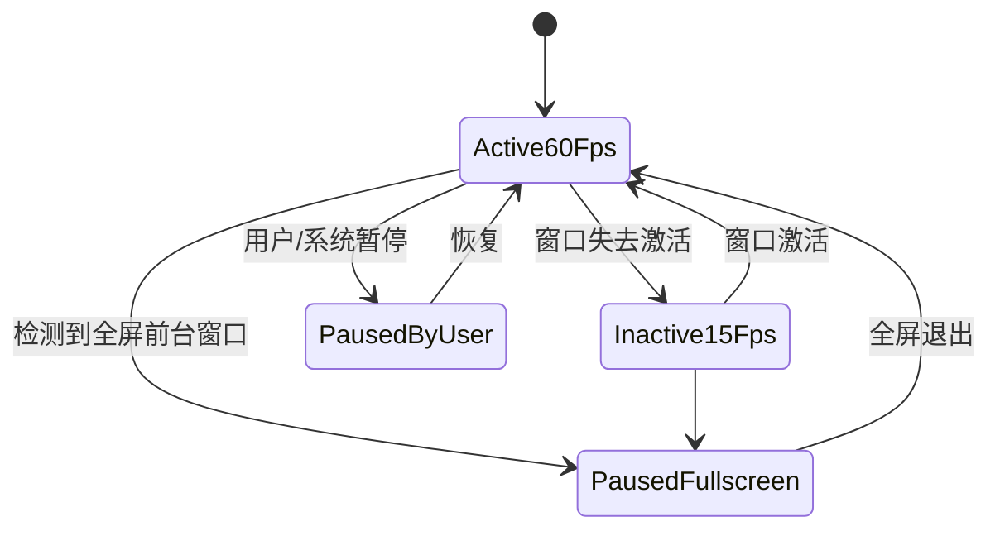
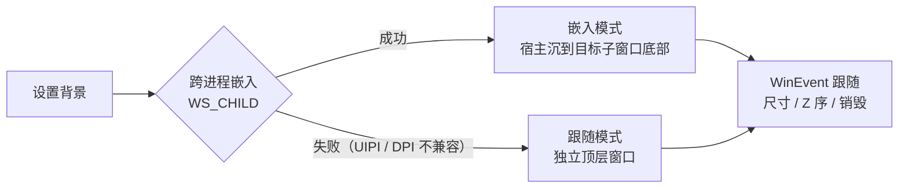

# 架构设计

## 1. 总体架构

解决方案 `WinCanvas.sln` 包含三个自研项目 + 两个 git 子模块，按「表现层 → 服务层 → 渲染层 → 第三方」分层：

```mermaid
graph TB
    subgraph App["表现层 WinCanvas.App（WinUI 3）"]
        APP["App.xaml.cs<br/>应用入口"] --> MW["MainWindow<br/>Mica 外观 / 服务装配 / 退出 Flush"]
        MW --> VM["MainViewModel<br/>列表 / 镜像属性 / 壁纸 / 设置"]
        VM --> WIVM["WindowItemViewModel<br/>单窗口属性 ↔ Win32 应用"]
        VM --> FPS["FpsMonitor<br/>CompositionTarget.Rendering 计数"]
        MW --> FP["FilePickerService<br/>文件选择器"]
    end

    subgraph Core["服务层 WinCanvas.Core"]
        WCS["IWindowControlService<br/>WindowControlService<br/>置顶/透明/穿透/圆角/枚举"]
        CFG["IConfigurationService<br/>ConfigurationService<br/>config.json 防抖落盘"]
        IF1["IWallpaperService（接口）"]
        IF2["IStatusNotifier（接口）"]
        KIS["KeyboardIndicatorService<br/>NumLock LL 键盘钩子<br/>专用消息线程 + 状态去抖"]
        NM["NativeMethods<br/>user32 / dwmapi / kernel32 P/Invoke"]
    end

    subgraph WP["渲染与解析层 WinCanvas.Wallpaper"]
        WS["WallpaperService<br/>三层策略 + 会话管理"]
        IMG["ImageWallpaperLoader<br/>ImageSharp 缩放<br/>GIF 多帧（WP5）"]
        VID["VideoWallpaperLoader<br/>MediaPlayer 硬解"]
        PKG["PkgWallpaperLoader<br/>repkg 解包 + 场景分析"]
        FMT["WallpaperFormats<br/>扩展名单一事实来源（WP5）"]
        LOOP["WallpaperRenderLoop<br/>专用后台渲染线程"]
        DFR["DynamicFrameRateController<br/>60/15/暂停三档状态机"]
        WNM["WallpaperNativeMethods<br/>全屏检测 / 显示器分辨率"]
        WTI["WinTipsIntegrationService<br/>进程调用 WinTips.exe / 本地回退"]
    end

    subgraph TP["ThirdParty（git 子模块）"]
        REPKG["repkg v0.4.0-alpha<br/>RePKG.Core + RePKG.Application<br/>pkg/tex 解析（源码项目引用）"]
        WTIPS["WinTips.exe<br/>net10.0-windows WPF 浮窗<br/>（MSBuild Target 外挂构建部署）"]
    end

    PERSIST[("JSON 配置持久化<br/>%APPDATA%/WinCanvas/config.json")]
    CACHE[("pkg 解包缓存<br/>%LOCALAPPDATA%/WinCanvas/wallpaper-cache")]

    VM -->|"枚举/置顶/透明/穿透/圆角"| WCS
    VM -->|"Load/Update/Flush"| CFG
    VM -->|"Initialize/Update/Pause/Resume"| IF1
    VM -->|"开关：IsEnabled + Start/Stop"| WTI
    VM -->|"Start / Stop（钩子启停）"| KIS
    KIS -->|"ShowNumLockStatus(isLocked)"| WTI
    WCS --> NM
    WS --> IMG & VID & PKG
    WS --> FMT
    IMG & VID & PKG -.->|"扩展名口径"| FMT
    WS --> LOOP
    LOOP --> DFR
    LOOP --> WNM
    PKG --> REPKG
    WTI -->|"--test num on|off"| WTIPS
    APP -.->|"BuildAndDeployWinTips Target<br/>dotnet build（.NET 10 SDK）+ 拷贝"| WTIPS
    CFG --> PERSIST
    PKG --> CACHE
    WS -.->|"实现"| IF1
    WTI -.->|"实现"| IF2
```

- **单向依赖**：App → Core + Wallpaper；Wallpaper → Core + repkg 子模块；Core 不依赖任何上层。
- **组合根**：`AppServices`（src/WinCanvas.App/Services/AppServices.cs:16）集中构造全部服务，`App.OnLaunched` 创建一次并注入 `MainWindow` / `MainViewModel`（src/WinCanvas.App/App.xaml.cs:22）。
- **进程模型**：单进程（`WindowsPackageType=None` 非打包 WinUI 3 桌面应用）；WinTips.exe 是唯一的跨进程交互，为一次性 `Process.Start` 且不等待退出。

## 2. 窗口管理模块

实现位于 `WindowControlService`（src/WinCanvas.Core/Services/WindowControlService.cs），四项能力全部通过 `Task.Run` 落到线程池执行，失败抛 `Win32Exception`（携带 GetLastError 错误码），由 ViewModel 捕获后经 InfoBar 提示：

| 能力 | Win32 交互 | 要点 |
| --- | --- | --- |
| 枚举窗口 | `EnumWindows` + `IsWindowVisible` / `GetWindowText` / `GetClassName` / `GetWindowThreadProcessId` | 过滤不可见、无标题窗口与已退出进程；排除应用自身句柄 |
| 置顶 | `SetWindowPos(HWND_TOPMOST/HWND_NOTOPMOST)` + `SWP_NOMOVE\|NOSIZE\|NOACTIVATE` | Toggle 与幂等 Set 两种语义；档案恢复先读 `WS_EX_TOPMOST` 真实状态、仅在不一致时 Set |
| 透明 | `WS_EX_LAYERED` + `SetLayeredWindowAttributes(LWA_ALPHA)` | 先用 `EnsureLayeredStyle` 补齐分层样式；0~255 |
| 穿透 | `WS_EX_TRANSPARENT` 位读写（`Get/SetWindowLongPtr`） | 必须与 `WS_EX_LAYERED` 成对置位 / 清零（src/WinCanvas.Core/Services/WindowControlService.cs:125） |
| 圆角 | `DwmSetWindowAttribute(DWMWA_WINDOW_CORNER_PREFERENCE=33)` | HRESULT 负值判定失败；Win10 旧版本不认识该属性会返回 E_INVALIDARG |

`GetWindowLongPtrCompat` / `SetWindowLongPtrCompat`（src/WinCanvas.Core/Native/NativeMethods.cs:191）按进程位数自动选择 `GetWindowLongPtrW` / `GetWindowLongW` 入口，保证 x86/x64 均能正确读写指针宽度的样式值。

## 3. 壁纸背景模块

### 四层加载策略

`WallpaperService.PrepareSource`（src/WinCanvas.Wallpaper/WallpaperService.cs）先问「是不是一个
Wallpaper Engine 项目目录」，再按扩展名分派；
扩展名口径统一取 `WallpaperFormats`（WP5 起的全仓库单一事实来源：图片 `.jpg/.jpeg/.png/.bmp/.gif/.webp`、
视频 `.mp4/.m4v/.mov/.webm/.wmv/.mkv/.avi`、pkg `.pkg`——加载器、服务分派、ViewModel 类型推断、
文件选择器过滤全部引用它，不再各自维护字面列表）：

0. **项目层（v0.3.0）** `WallpaperProjectLoader`：输入是**目录**时接管。读同目录 `project.json`
   （`WallpaperProjectReader`，纯逻辑、永不抛）判定 `fileType` 后转交给下面三层之一 ——
   `scene` → 该项目的 `scene.pkg` 走 pkg 层（解不开就退化到封面/预览图并说明原因）；
   `video` → 视频层；`web` → **不渲染网页**，用 preview 图顶替并给出明确理由；
   `audiofilter` / 无法识别 → `NotSupportedException` 带人话原因，绝不「猜一个能播的文件」。
   三条纪律：① 返回的 `WallpaperSource.OriginalPath` 恒为**项目目录**（配置里记的、恢复时找的
   都是目录，所以 `WallpaperFormats.IsAvailableBackgroundPath` 必须同时认目录与文件，
   否则每条目录型壁纸都会在启动恢复时被误判成「文件已不存在」）；
   ② `project.json` 是第三方文件，里面写的相对路径一律经 `ResolveRelative` 做目录穿越检查；
   ③ 大小写不敏感（真实库里同时存在 `scene`/`Scene`/`Video`/`video`）。
1. **图片层** `ImageWallpaperLoader`：ImageSharp 解码 → 目标显示器分辨率内等比 Lanczos 缩放（只缩小不放大；目标分辨率由 `WallpaperNativeMethods.TryGetMonitorResolutionForWindow` 提供）→ Bgra32 像素整块拷贝为 Bgra8 `SoftwareBitmap`。多帧 GIF（WP5）解码全部帧到 `WallpaperSource.ImageFrames`（每帧含画面与 GIF 帧延迟，1/100 秒换算；帧数受 256MB 像素预算 / 240 帧上限截断），首帧同时作为 `ImageFrame` 兼容既有渲染判定。
2. **视频层** `VideoWallpaperLoader`：创建 `MediaPlayer`（Media Foundation 硬解），循环播放；**是否静音由 `AppConfig.WallpaperAudioEnabled` 决定（v0.3.0，默认静音）**，开启时按 `DefaultPlaybackVolume = 0.6` 播放。旧实现把 `IsMuted` 硬编码成 `true`，带配乐的壁纸没有任何办法出声。
3. **pkg 层** `PkgWallpaperLoader`：`PackageReader` 读条目表 → 解包到内容 hash 命名的缓存目录（SHA256 取文件头 1MB，防抖期间重复解包直接复用）→ `.tex` 经 `TexReader` 解码为 PNG / 还原内嵌 mp4 → 场景分析：含 `.lua` 或 scene.json 引用 script 的复杂 SceneScript 场景降级为封面图；否则内嵌视频走视频层、最大 PNG 走图片层。

### 线程与渲染模型

- **专用渲染线程**：每个承载窗口一个 `WallpaperRenderLoop`，线程名 `WinCanvas.Wallpaper.Render`，`IsBackground=true`、`BelowNormal` 优先级；`Stopwatch` 单调时钟计帧，落后时直接重新对齐避免追帧风暴；单帧回调异常不杀死线程（src/WinCanvas.Wallpaper/Rendering/WallpaperRenderLoop.cs:60）。
- **动态帧率**：`DynamicFrameRateController` 三档状态机（激活 60fps / 非激活 15fps / 全屏或用户暂停）；暂停态按 ~8fps 轮询恢复条件；全屏检测节流至每 250ms 一次。
- **状态联动**：暂停渲染时同步 `MediaPlayer.Pause()`（省解码器），恢复时继续播放（src/WinCanvas.Wallpaper/WallpaperService.cs:194）。
- **会话管理**：`hwnd -> WallpaperSession` 字典 + 短临界区锁；切换资源先摘旧回调再 `Dispose`，避免在途帧回调触碰已释放资源。
- **UI 封送约定**：渲染线程与线程池上的事件（`StatusReported` / `ImageFrameReady` / `StateChanged`）一律由订阅方自行封送；`MainViewModel.ShowInfo` 用 `DispatcherQueue.TryEnqueue` 切回 UI 线程（src/WinCanvas.App/ViewModels/MainViewModel.cs:453）。
- **上屏接线（已完成）**：App 层 `WallpaperPreviewController` 订阅 `ImageFrameReady`（渲染线程内同步复制像素 → DispatcherQueue → WriteableBitmap → 预览 Image）与 `VideoPlayerReady`（MediaPlayerElement.SetMediaPlayer 输出）。

### 宿主窗口与背景上屏（WP1，src/WinCanvas.Wallpaper/Hosting）

设置背景后画面真实呈现在目标窗口内部。承载者是属于本进程的 Win32 宿主窗口
（类名 `WinCanvasWallpaperHost`），由 `Hosting/WallpaperHostWindow` 封装，两条挂接路径自动选择：

- **嵌入模式（首选）**：`WS_CHILD` 子窗口 + 目标为客户区父窗口，尺寸 = `GetClientRect(target)`，
  沉底（`HWND_BOTTOM`）后目标自绘背景被覆盖、既有子控件在其上继续可见可点。目标移动时子窗口
  自动跟随；监听 `EVENT_OBJECT_LOCATIONCHANGE`（客户区尺寸变化）与 `EVENT_OBJECT_REORDER`
  （Z 序被调）同步宿主。
- **跟随模式（回退）**：嵌入被拒（UIPI / DPI 上下文不兼容 / 目标已销毁）时降级为 `WS_POPUP`
  独立窗口（`NOACTIVATE | TOOLWINDOW | LAYERED | TRANSPARENT`），跟随目标外接矩形
  （优先 `DwmGetWindowAttribute(DWMWA_EXTENDED_FRAME_BOUNDS)`）、Z 序钉在目标正下方，
  监听 SHOW / HIDE / MINIMIZESTART/END 同步显隐。目标不透明时自动应用轻度透明（alpha=220）。
- **降级与异常检测**：A1 挂接观察窗内焦点异常（宿主获得键盘焦点）或父子关系被目标侧改动 →
  自动降级 A2；目标销毁（`EVENT_OBJECT_DESTROY` / 宿主 `WM_DESTROY` 双信号）→ 会话
  Dispose + 宿主销毁。
- **线程模型（宿主专用 pump 线程）**：全部宿主窗口与 WinEvent 钩子在
  `Hosting/WallpaperHostPump` 的专用消息线程（线程名 `WinCanvas.Wallpaper.HostPump`）上创建与
  操作——跨线程 `DestroyWindow` 非法、`WINEVENT_OUTOFCONTEXT` 回调要求安装线程跑消息循环；
  外部调用经 `Execute`（`PostThreadMessageW` + 信号等待）封送，线程启动时 `CoInitializeEx(STA)`
  + PeekMessage 强制建消息队列。
- **图片上屏（B 阶段）**：`WallpaperHostRenderer` 的 DComp 树（设备 → Target → Visual →
  Surface），逐次 `BeginDraw → IDXGISurface1::GetDC → GDI StretchDIBits（HALFTONE）→
  EndDraw → Commit`；表面按客户区尺寸重建，静态图零逐帧工作；设备失陷整树重建。
- **GIF 动画上屏（WP5）**：壁纸会话在渲染线程按帧延迟推进——`FrameTick` 到达且当前帧
  展示期满时索引推进 +1，`BitmapSnapshot.CopyFrom` 同步复制新帧像素（会话 `_tickGate`
  锁内，与 Dispose 互斥），经服务层回调交宿主 `RenderImage` 重贴 + Commit；首帧由
  `UpdateCoreAsync` 的静态路径一次性上屏。暂停态渲染循环不出帧 → 动画自然定格，
  恢复后继续（与视频播放器联动同一状态机）。预览旁路只显示首帧。
- **视频上屏（C 阶段，ADR：组合呈现）**：`Hosting/CompositionVideoPresenter` 以
  `MediaPlayer.GetSurface(compositor)` 拿播放器组合表面 → SurfaceBrush → SpriteVisual →
  `ICompositorDesktopInterop.CreateDesktopWindowTarget` 绑定宿主 HWND；画面由 MF + 系统组合
  引擎直接呈现（零拷贝、零逐帧）；SpriteVisual 按 `NaturalVideoWidth/Height` 等比加边居中，
  自持专用 DispatcherQueue 线程（组合对象要求创建线程持有 DQ）。主路径（帧服务器
  `CopyFrameToVideoSurface`）实测受阻（逐帧 BeginDraw E_OUTOFMEMORY / 对外部翻转缓冲
  CopyFrameToVideoSurface AV），ADR 全文见 WORKLOG 阶段 C。
- **跨屏重缩放（D 阶段）**：加载时显示器分辨率记录于 `WallpaperService._monitorResAtLoad`；
  宿主 `ClientSizeChanged`（WinEvent 尺寸同步 / `WM_DPICHANGED` 之后）触发比对，分辨率变化即
  按源路径重新走加载管线（新显示器分辨率下 Lanczos 重缩放）。
- **预览旁路**：主窗口预览区为派生显示（图片快照副本上屏；视频的组合呈现路径下预览为空，
  主输出 = 目标窗口）。

## 4. WinTips 提示模块（NumLock 键盘钩子链路，WP2）

### 事件源：KeyboardIndicatorService（src/WinCanvas.Core/Services/KeyboardIndicatorService.cs）

- 低级键盘钩子（`SetWindowsHookExW(WH_KEYBOARD_LL)`）安装在**专用后台消息线程**（线程名 `WinCanvas.KeyboardHook`）上：该线程先 `PeekMessageW` 建队、记录 Win32 线程 Id、装钩，然后跑 `GetMessageW` 循环（空闲零 CPU）；停止时外部向该线程 `PostThreadMessageW(WM_QUIT)`，循环退出后由钩子线程自身 `UnhookWindowsHookEx`（时序保证卸载发生在最后一次回调之后）。
- 回调内只过滤 `WM_KEYDOWN/WM_KEYUP` 且 `vkCode == VK_NUMLOCK(0x90)` 的事件，读一次 `GetKeyState` 切换位并与上次上报值去抖（Interlocked）：**状态变化才上报**——按住自动重复、KEYDOWN/KEYUP 双时机读到同值都被抑制；KEYDOWN/KEYUP 各读一次的自纠错设计不依赖系统翻转时机，每次翻转恰好上报一次正确新状态。
- 回调微秒级返回（只读状态 + 整数比较），上报动作经线程池派发到 `IStatusNotifier.ShowNumLockStatus`——绝不拖慢全系统键盘输入，也绝不吞键（永远 `CallNextHookEx` 放行）。
- 生命周期：主界面「WinTips 提示」开关开→`Start()`（托管线程创建，UI 线程零 P/Invoke）、关→`Stop()`（投递/等待派发线程池）；应用退出 `MainWindow.Closed → Dispose()` 显式卸钩，与进程退出对 IsBackground 线程的回收构成双保险。
- 诊断日志：`%LOCALAPPDATA%/WinCanvas/logs/keyboard-diag.log`（安装/状态变化/去抖抑制/Unhook 完成，`KeyboardDiagnostics` 静态类，失败静默）。

### 呈现：WinTipsIntegrationService（src/WinCanvas.Wallpaper/WinTipsIntegrationService.cs）

1. 优先：进程调用已部署的 `WinTips.exe --test num on|off [holdSeconds]`（一次性启动、不等待退出，避免阻塞调用线程）；
2. 回退：找不到 exe 或启动失败时触发本地事件 `NumLockTipRequested`，由 `MainViewModel` 订阅后在 InfoBar 显示。

- exe 定位顺序：显式注入路径 → 程序目录旁 `WinTips\WinTips.exe` → `%LOCALAPPDATA%\Programs\WinTips\WinTips.exe` 等候选。
- `IsEnabled` 开关关闭时静默忽略，不产生进程启动或回退事件。
- WinTips 子模块本身（net10.0-windows WPF WinExe）不加入 `WinCanvas.sln`、不项目引用：由 `WinCanvas.App.csproj` 的 `BuildAndDeployWinTips` Target（`AfterTargets="Build"`，Inputs/Outputs 增量）用 .NET 10 SDK 外挂构建 `-c Release` 并把产物拷到 `$(OutDir)WinTips\`；构建失败仅产生 warning（运行期自动走 InfoBar 回退），不阻断主构建。

## 5. 状态重启自动恢复（WP3，src/WinCanvas.App/ViewModels/MainViewModel.cs）

目标：设置某窗口背景与属性 → 完全重启应用 → 不做任何操作，该窗口的置顶 / 透明 / 穿透 / 圆角 / 背景自动恢复。

### 恢复管线（MainViewModel.QueueRestorePipeline / RunRestorePipelineCoreAsync）

- **触发点**：`RefreshAsync` 在窗口列表重建完成后调用 `QueueRestorePipeline`——启动初始化
  （`InitializeAsync → RefreshAsync`）与手动「刷新」都会触发；列表先可用，管线只入队即返回，
  恢复全程后台进行（不阻塞首帧渲染）。
- **排队策略**：待恢复档案按 **200ms 间隔逐个派发**（`RestoreDispatchIntervalMs`），
  同时在途恢复不超过 **2** 个（`RestoreMaxConcurrency`，BCL `SemaphoreSlim`）——防启动风暴。
- **管线串行**：多条管线经任务链（`_restorePipelineTask`）依次执行，连续刷新不会并发恢复。
- **单窗口流程**：① 属性恢复——直接复用既有 `WindowItemViewModel.RestoreAsync`
  （幂等置顶语义：先读 `WS_EX_TOPMOST` 真实状态，仅不一致时 Set），经 `DispatcherQueue.TryEnqueue`
  封送到 UI 线程执行（`RestoreAsync` 会写可绑定属性，x:Bind 的更新不做跨线程封送；其内部
  Win32 调用本就在线程池）；② 壁纸恢复——档案 `BackgroundPath` 存在且文件存在 →
  复用 `IWallpaperService.UpdateWallpaperAsync`（内部经 `_updateGates` 每窗口串行 + 线程池加载）。
- **幂等（不新增独立锁体系）**：会话级判重账本 `ConcurrentDictionary<IntPtr, byte>`
  （`_pipelineProcessedHwnds`，原子 TryAdd / TryRemove）保证同一 hwnd 只恢复一次；
  背景再用壁纸**会话字典**判重（`IWallpaperService.IsBackgroundActive`，实现查 `_sessions`
  短临界区）跳过重复加载；恢复失败撤销判重标记，下次刷新可重试。
- **背景文件缺失**：`File.Exists` 不通过时 InfoBar 警告「背景文件已不存在：…，档案保留」，
  **不清除档案**（用户可能临时移动文件）；属性部分照常恢复。
- **开关**：`AppConfig.AutoRestoreOnStartup`（默认 true）↔ 设置区「启动时自动恢复窗口状态」
  Toggle；关闭时整条管线跳过（日志留证）。
- **恢复匹配**：以 `WindowState.Key`（进程名|类名）为主键重新定位窗口，hwnd 重启后变化不影响。
- **诊断日志**：`RestoreDiagnostics` → `%LOCALAPPDATA%/WinCanvas/logs/restore-diag.log`
  （进程启动 / 列表可用 / 单窗口恢复 / 幂等跳过 / 文件缺失警告 / 全部完成，均带耗时）。
  写入模型为「无界 Channel + 唯一后台任务落盘」：`Log()` 只做非阻塞入队，UI 线程可安全调用。

## 6. MVVM 与线程模型

### MVVM

- 采用 CommunityToolkit.Mvvm（`ObservableObject` + `[ObservableProperty]` + `[RelayCommand]` 源生成器），XAML 用 `x:Bind` 绑定 ViewModel。
- `MainWindow` code-behind 只做视觉装饰（Mica / 标题栏）、服务装配与退出前 `FlushAsync`；业务逻辑全部在 `MainViewModel`（src/WinCanvas.App/ViewModels/MainViewModel.cs:29）。
- `WindowItemViewModel` 包装运行期 `WindowInfo` 快照与持久化 `WindowState` 档案：属性变更立即应用 Win32 并持久化；`RestoreAsync` 在选中时把档案值真正应用回窗口，保证「界面开关 / 档案 / 窗口真实状态」三者一致（WP3 的恢复管线复用同一方法）。
- 主界面使用**镜像属性**（`SelectedIsTopmost` 等）而不是把控件 TwoWay 直接绑到可空 `Selected`，防止换选瞬间旧控件值误写进新选中项（src/WinCanvas.App/ViewModels/MainViewModel.cs:103）。
- 设置区开关统一改用 `[ObservableProperty] public partial T Xxx { get; set; }`（**partial 属性**形式）：
  字段形式在 WinUI 3 场景会生成 MVVMTK0045（AOT/WinRT 下字段不可观测）警告，
  v0.2.0 迁移时把 21 处字段全部转成 partial 属性。另有大量 MSB3277 程序集版本冲突警告
  来自子模块 RePKG 的 `System.Drawing.Common` 引用，由仓库根 `Directory.Build.targets` 里
  一条 `PackageReference Remove` 收口（**不改子模块源码**，否则子模块一更新就重新长出来）。
  当前 `dotnet build -c Release` 为 0 警告 0 错误。
- UIPI 权限引导（WP5）：`WindowItemViewModel` 四类属性操作与恢复管线的 catch 统一经 `ProcessElevation.DescribeFailure` 翻译——错误 5（ERROR_ACCESS_DENIED）给出「以管理员身份重启」专项引导，其余异常原语义透传；设置区「当前权限」文本（`ElevationStatusText`）来自 `ProcessElevation.IsElevated`（进程启动时检测一次并缓存）。

### 线程模型

| 线程 | 职责 | 来源 |
| --- | --- | --- |
| UI 线程 | XAML / ViewModel 属性 / `DispatcherQueue.TryEnqueue` 封送后的提示更新 | WinUI 3 |
| 线程池（Task.Run） | 窗口枚举、全部 Win32 窗口操作、壁纸资源准备（解码/解包）、配置防抖写盘、NumLock 上报派发、恢复管线排队与壁纸恢复（WP3） | `WindowControlService` / `WallpaperService` / `ConfigurationService` / `KeyboardIndicatorService` / `MainViewModel` 恢复管线 |
| `WinCanvas.Wallpaper.Render` 后台线程 | 逐帧 `FrameTick` 回调、全屏检测（250ms 节流）、渲染状态上报 | `WallpaperRenderLoop`，BelowNormal 优先级 |
| `WinCanvas.Wallpaper.HostPump` 专用消息线程 | 宿主窗口创建/销毁/跟随、WinEvent 钩子回调（WP1） | `WallpaperHostPump`，STA |
| `WinCanvas.KeyboardHook` 专用消息线程 | LL 键盘钩子安装/回调/卸载，`GetMessageW` 循环空闲零 CPU（WP2） | `KeyboardIndicatorService`，Normal 优先级 |
| `WinCanvas.SystemMessage` 专用消息线程 | 隐藏顶层窗口：托盘回调 `WM_TRAYICON`、全局热键 `WM_HOTKEY`、`WM_INVOKE` 封送通道（v0.2.0） | `MessagePumpWindow`，IsBackground |
| 线程池（`Task.Run`） | 壁纸库扫描（真实库 96 条实测 27ms，仍放后台防目录在网络盘时卡 UI）、缩略图解码（`SemaphoreSlim(1,1)` 串行） | `MainViewModel.WallpaperLibrary` / `WallpaperLibraryItemViewModel`（v0.3.0） |

跨线程数据保护：

- `ConfigurationService`：`_syncLock` 保护缓存与防抖任务，`SemaphoreSlim(1,1)` 串行化磁盘写，防抖 500ms 合并批量落盘（src/WinCanvas.Core/Services/ConfigurationService.cs:16）。
- `WallpaperService`：`_gate` 锁保护会话字典，临界区只做会话替换；资源准备在锁外执行。
- `DynamicFrameRateController`：三个 `volatile bool` 状态位，无锁读取。
- 恢复管线（WP3）：`_pipelineProcessedHwnds` 为 `ConcurrentDictionary` 原子判重账本（非锁体系）；管线串行靠任务链（`_restorePipelineTask`，UI 线程读写）；壁纸加载串行完全复用 `WallpaperService._updateGates` / `_gate` / 会话字典，未新增任何独立锁。
- 后台线程事件到 UI：统一经 `DispatcherQueue.TryEnqueue` 封送（`MainViewModel.ShowInfo` / FPS 文本 / 恢复管线的属性应用）。

## 7. 依赖与外部接口

| 依赖 | 形式 | 用途 |
| --- | --- | --- |
| Microsoft.WindowsAppSDK 1.8.260921001 | NuGet | WinUI 3 运行时（SelfContained，非打包部署） |
| CommunityToolkit.Mvvm 8.4.2 | NuGet | MVVM 源生成器 |
| SixLabors.ImageSharp 2.1.9 | NuGet | 图片解码与缩放（与 repkg 同版本，避免依赖冲突） |
| RePKG.Core / RePKG.Application | git 子模块源码项目引用（netstandard2.0） | Wallpaper Engine pkg/tex 解析 |
| WinTips | git 子模块，MSBuild Target 外挂构建（.NET 10 SDK）+ 进程调用其 exe | NumLock 浮窗提示 |
| user32.dll / dwmapi.dll / kernel32.dll | P/Invoke | 窗口枚举与属性、圆角、显示器信息、LL 键盘钩子 |

配置与缓存路径：`%APPDATA%/WinCanvas/config.json`（UTF-8 无 BOM）；`%LOCALAPPDATA%/WinCanvas/wallpaper-cache/<文件名-hash>/`（pkg 解包缓存）。

## 8. 自动化测试（WP4 / WP5）

- `tests/WinCanvas.Core.Tests`（63 用例）与 `tests/WinCanvas.Wallpaper.Tests`（123 用例），xUnit + `dotnet test` 全绿；合计 186 例。
- v0.2.0 新增覆盖（此前这些路径 0 覆盖，缺陷因此长期存在）：配置服务的**活对象撕裂**与
  **CTS 世代竞态**、`.bak` 恢复与坏文件隔离、Dispose 兜底落盘；全局热键表的默认补齐 /
  用户值不被覆盖 / 三类校验 / 默认表自身无冲突 / 目录覆盖全部枚举值；
  壁纸呈现路径分派的不变式（`Kind` 与 `HasVideoPlayer` 互不蕴含 —— pkg 内嵌视频
  的 `Kind` 是 `Pkg` 但必须走视频层）。
- `HotkeyTable` 原在 `WinCanvas.App.Services`，因不依赖任何 UI 类型而**移到 `WinCanvas.Core.Services`**：
  留在 App 就进不了现有测试工程（迁移前 App 层是 0 覆盖）。
- 覆盖：配置防抖合并 / 原子写 / 无 BOM、窗口档案键语义、`WindowControlService` 失败语义（无效句柄抛 `Win32Exception`）与真实窗口行为冒烟、NumLock 去抖纯逻辑（`NumLockStateDebouncer`）、动态帧率状态机真值表、pkg 加载器纯逻辑（路径安全 / 场景判定 / 封面优先级）、宿主挂接矩形与 DPI 换算纯函数；WP5 新增：扩展名单一来源口径（`WallpaperFormats` 与两侧加载器一致性）、合成动画 GIF 的多帧 / 帧延迟 / 首帧别名往返、静态 WebP 解码、UIPI 错误 5 提权引导文案映射（`ProcessElevation`）。
- 被测项目经 `InternalsVisibleTo` 对测试程序集开放 internal 纯逻辑（`SafeJoin` / `DetectComplexScene` / `FindCoverImage` / `WallpaperHostWindow` 矩形函数 / `NumLockStateDebouncer`）；公共 API 面不变。
- 需要真实桌面会话的用例打 `[Trait("Category", "RequiresWindowsSession")]`，无头环境用 `--filter "Category!=RequiresWindowsSession"` 排除（xunit 2.9.2 无运行时跳过机制，结论见 WORKLOG WP4）。
- 行为级验收（真实宿主上屏）由不入 sln 的诊断命令承担：`tools/Wp1AHostDiag`（WP1）、`tools/Wp5FormatDiag`（WP5：GIF 播放 / 暂停定格 / webp 上屏 / 权限引导）、`tools/WvLibraryDiag`（v0.3.0：WE 库扫描形态统计 + 不可用原因直方图 + **逐条交叉校验「扫描说可用」与「加载器真的分派」**，不一致即非零退出）。

## 9. 应用外壳与壁纸库（v0.2.0 / v0.3.0）

### 为什么托盘与热键共用一个隐藏窗口

`Shell_NotifyIcon` 与 `RegisterHotKey` 都要求「有一个窗口收消息」。各开一个就是两条常驻消息线程；
合到一个 `WS_POPUP`、无 `WS_VISIBLE`、0×0 的隐藏窗口上，进程只多一条线程 + 一个 HWND。
不用 message-only 窗口（`HWND_MESSAGE`）：它与托盘 `TrackPopupMenuEx` 的前台/焦点配合不可靠，
是「菜单点了不关、鼠标穿透」这类老毛病的来源。

三条线程纪律：

1. **热键必须在创建该窗口的线程上注册** —— `WM_HOTKEY` 投给注册调用所在线程的队列，
   从 UI 线程注册的话消息全去 UI 队列，本窗口的 WndProc 一条也收不到，
   表现为「注册成功但按了没反应」。故 `ApplyAsync` 经 `InvokeAsync` 封送到泵线程。
2. **封送用 PostMessage + TCS + 超时，不用 SendMessage** —— 泵线程此刻可能正卡在模态托盘菜单里，
   同步消息会把 UI 线程一起挂住。超时（5 秒）后如实报告「热键未重新注册」，不静默假装成功。
3. **WndProc 绝不让托管异常穿到非托管帧** —— 那会在消息派发路径上直接终结进程，
   症状是「不知为什么程序就没了」。路由表用 `ConcurrentDictionary<IntPtr, …>` 而不是
   `GWLP_USERDATA` + `GCHandle`：后者漏一次 `Free` 就是 use-after-free。

`App.LogFatal` 会把每次应用绑定表的结果写一行进 `logs/crash.log`（成功 N 条 / 失败 M 条 + 原因）：
用户收进托盘后看不到界面红字，日志是远程排障的唯一入口。

**验证热键时最容易踩的坑在测试脚本，不在被测程序**：`SendInput` 的 `cbSize` 必须等于
真实的 `sizeof(INPUT)`（x64 = 40：`type` 4 + 对齐 4 + 联合体 32）。联合体若只按
`KEYBDINPUT`（24 字节）声明，托管侧算出来就是 32，`SendInput` **直接返回 0、什么都不注入**，
而全局热键「注册成功」的日志照写 —— 于是看起来像「热键功能坏了」。
v0.3.0 就在这里白折腾过一轮：`RegisterHotKey` 11/11 成功、`WM_HOTKEY` 一条不来，
最后用一个独立探针进程（同样的注入代码 + 正确的 40 字节）收到 3/3 才定位到脚本。
所以：**注入函数返回值必须检查**，并且判断「热键是否生效」要看副作用（窗口可见性、
`config.json` 里的字段翻转），不要只看有没有报错。

### 单实例与关闭语义

第二实例不再重复起界面：`Global\WinCanvas.App.SingleInstance` 互斥体 +
`Global\WinCanvas.App.ShowMainWindow` 唤醒事件，第二个实例唤醒已有实例后自行退出
（迁移前两个实例同写一份 `config.json` 互相覆盖，表现为「设置莫名回滚」）。
有托盘时点 X = 收进托盘（`AppWindow.Closing` 里 `args.Cancel`），真退出走托盘菜单，由 `_isExiting` 放行。
安装包 `AppMutex` 与互斥体同名，避免安装时「文件被占用」却不知道为什么。

### 壁纸库的分层取舍

- **可挂接判定只有一处真源**：`WallpaperEngineLibrary.Classify` 与
  `WallpaperProjectLoader.Load` 的分派口径**刻意保持一致**，并由 `tools/WvLibraryDiag` 逐条交叉校验。
  库里出现「看着能点、点下去报错」的条目比条目少几条糟糕得多。
- **扫描深度限制一层**：WE 库的布局是 `<根>/<id>/project.json`；递归下去会撞上
  shaders / materials / sound 这些素材目录，产出大量无意义条目。
- **非 Steam 部署必须能手填**：自动探测只认 Steam（注册表 App 431960 / 标准路径 /
  `libraryfolders.vdf` / `workshop/content/431960`），实测本机（壁纸项目放在
  `E:\SublimeTextzip\wallpaper_engine\projects\myprojects`）自动探测结果为 **0 个根**，
  手填该目录后 96 条全部可用。用户配置根优先、自动探测兜底、按路径忽略大小写去重。
- **缩略图按需 + 串行**：WinUI 的 `BitmapImage` 会解码并**保留 GIF 的每一帧**，
  面板里上百个条目同时构造预览会把私有内存从 48MB 顶到 247MB（实测）。
  改为 View 的 `Loaded` 事件驱动（只处理滚进视口的条目）+ `SemaphoreSlim(1,1)` 串行解码 +
  解码后立即缩到 120px 存 PNG + 封回 UI 线程 `SetSourceAsync`，回落到 102MB。
- **音频开关是全局单值**：`AppConfig.WallpaperAudioEnabled` → `IWallpaperService.AudioEnabled`，
  写入即时作用到正在播放的会话（`WallpaperSession.ApplyAudio` 在 `_tickGate` 下改
  `IsMuted` / `Volume`）。「哪张壁纸该出声」的逐条目控制留给后续版本 ——
  先把「默认不打扰、要听一键开」这条主路径做实。
