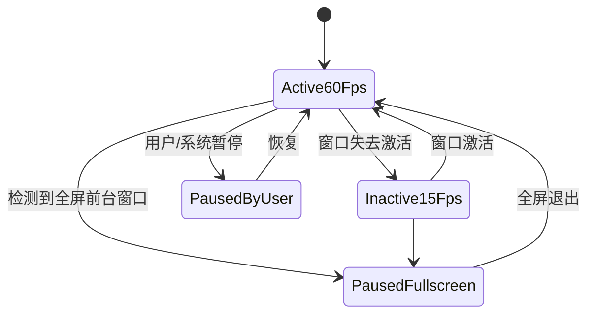

# 架构设计

## 1. 总体架构

解决方案 `WinCanvas.sln` 包含三个自研项目 + 两个 git 子模块，按「表现层 → 服务层 → 渲染层 → 第三方」分层：

```mermaid
graph TB
    subgraph App["表现层 WinCanvas.App（WinUI 3）"]
        APP["App.xaml.cs<br/>应用入口"] --> MW["MainWindow<br/>Mica 外观 / 服务装配 / 退出 Flush"]
        MW --> VM["MainViewModel<br/>列表 / 镜像属性 / 壁纸 / 设置"]
        VM --> WIVM["WindowItemViewModel<br/>单窗口属性 ↔ Win32 应用"]
        VM --> FPS["FpsMonitor<br/>CompositionTarget.Rendering 计数"]
        MW --> FP["FilePickerService<br/>文件选择器"]
    end

    subgraph Core["服务层 WinCanvas.Core"]
        WCS["IWindowControlService<br/>WindowControlService<br/>置顶/透明/穿透/圆角/枚举"]
        CFG["IConfigurationService<br/>ConfigurationService<br/>config.json 防抖落盘"]
        IF1["IWallpaperService（接口）"]
        IF2["IStatusNotifier（接口）"]
        NM["NativeMethods<br/>user32 / dwmapi P/Invoke"]
    end

    subgraph WP["渲染与解析层 WinCanvas.Wallpaper"]
        WS["WallpaperService<br/>三层策略 + 会话管理"]
        IMG["ImageWallpaperLoader<br/>ImageSharp 缩放"]
        VID["VideoWallpaperLoader<br/>MediaPlayer 硬解"]
        PKG["PkgWallpaperLoader<br/>repkg 解包 + 场景分析"]
        LOOP["WallpaperRenderLoop<br/>专用后台渲染线程"]
        DFR["DynamicFrameRateController<br/>60/15/暂停三档状态机"]
        WNM["WallpaperNativeMethods<br/>全屏检测 / 显示器分辨率"]
        WTI["WinTipsIntegrationService<br/>进程调用 WinTips.exe / 本地回退"]
    end

    subgraph TP["ThirdParty（git 子模块）"]
        REPKG["repkg v0.4.0-alpha<br/>RePKG.Core + RePKG.Application<br/>pkg/tex 解析（源码项目引用）"]
        WTIPS["WinTips.exe<br/>net10.0-windows WPF 浮窗<br/>（仅进程调用，不参与构建）"]
    end

    PERSIST[("JSON 配置持久化<br/>%APPDATA%/WinCanvas/config.json")]
    CACHE[("pkg 解包缓存<br/>%LOCALAPPDATA%/WinCanvas/wallpaper-cache")]

    VM -->|"枚举/置顶/透明/穿透/圆角"| WCS
    VM -->|"Load/Update/Flush"| CFG
    VM -->|"Initialize/Update/Pause/Resume"| IF1
    VM -->|"IsEnabled / LogMessage / NumLockTipRequested"| WTI
    WCS --> NM
    WS --> IMG & VID & PKG
    WS --> LOOP
    LOOP --> DFR
    LOOP --> WNM
    PKG --> REPKG
    WTI -->|"--test num on|off"| WTIPS
    CFG --> PERSIST
    PKG --> CACHE
    WS -.->|"实现"| IF1
    WTI -.->|"实现"| IF2
```

- **单向依赖**：App → Core + Wallpaper；Wallpaper → Core + repkg 子模块；Core 不依赖任何上层。
- **组合根**：`AppServices`（src/WinCanvas.App/Services/AppServices.cs:16）集中构造全部服务，`App.OnLaunched` 创建一次并注入 `MainWindow` / `MainViewModel`（src/WinCanvas.App/App.xaml.cs:22）。
- **进程模型**：单进程（`WindowsPackageType=None` 非打包 WinUI 3 桌面应用）；WinTips.exe 是唯一的跨进程交互，为一次性 `Process.Start` 且不等待退出。

## 2. 窗口管理模块

实现位于 `WindowControlService`（src/WinCanvas.Core/Services/WindowControlService.cs），四项能力全部通过 `Task.Run` 落到线程池执行，失败抛 `Win32Exception`（携带 GetLastError 错误码），由 ViewModel 捕获后经 InfoBar 提示：

| 能力 | Win32 交互 | 要点 |
| --- | --- | --- |
| 枚举窗口 | `EnumWindows` + `IsWindowVisible` / `GetWindowText` / `GetClassName` / `GetWindowThreadProcessId` | 过滤不可见、无标题窗口与已退出进程；排除应用自身句柄 |
| 置顶 | `SetWindowPos(HWND_TOPMOST/HWND_NOTOPMOST)` + `SWP_NOMOVE\|NOSIZE\|NOACTIVATE` | Toggle 与幂等 Set 两种语义；档案恢复先读 `WS_EX_TOPMOST` 真实状态、仅在不一致时 Set |
| 透明 | `WS_EX_LAYERED` + `SetLayeredWindowAttributes(LWA_ALPHA)` | 先用 `EnsureLayeredStyle` 补齐分层样式；0~255 |
| 穿透 | `WS_EX_TRANSPARENT` 位读写（`Get/SetWindowLongPtr`） | 必须与 `WS_EX_LAYERED` 成对置位 / 清零（src/WinCanvas.Core/Services/WindowControlService.cs:125） |
| 圆角 | `DwmSetWindowAttribute(DWMWA_WINDOW_CORNER_PREFERENCE=33)` | HRESULT 负值判定失败；Win10 旧版本不认识该属性会返回 E_INVALIDARG |

`GetWindowLongPtrCompat` / `SetWindowLongPtrCompat`（src/WinCanvas.Core/Native/NativeMethods.cs:191）按进程位数自动选择 `GetWindowLongPtrW` / `GetWindowLongW` 入口，保证 x86/x64 均能正确读写指针宽度的样式值。

## 3. 壁纸背景模块

### 三层加载策略

`WallpaperService.PrepareSource`（src/WinCanvas.Wallpaper/WallpaperService.cs:119）按扩展名分派：

1. **图片层** `ImageWallpaperLoader`：ImageSharp 解码 → 目标显示器分辨率内等比 Lanczos 缩放（只缩小不放大；目标分辨率由 `WallpaperNativeMethods.TryGetMonitorResolutionForWindow` 提供）→ Bgra32 像素整块拷贝为 Bgra8 `SoftwareBitmap`。
2. **视频层** `VideoWallpaperLoader`：创建 `MediaPlayer`（Media Foundation 硬解），静音 + 循环，不自动播放，启停交给帧率状态机。
3. **pkg 层** `PkgWallpaperLoader`：`PackageReader` 读条目表 → 解包到内容 hash 命名的缓存目录（SHA256 取文件头 1MB，防抖期间重复解包直接复用）→ `.tex` 经 `TexReader` 解码为 PNG / 还原内嵌 mp4 → 场景分析：含 `.lua` 或 scene.json 引用 script 的复杂 SceneScript 场景降级为封面图；否则内嵌视频走视频层、最大 PNG 走图片层。

### 线程与渲染模型

- **专用渲染线程**：每个承载窗口一个 `WallpaperRenderLoop`，线程名 `WinCanvas.Wallpaper.Render`，`IsBackground=true`、`BelowNormal` 优先级；`Stopwatch` 单调时钟计帧，落后时直接重新对齐避免追帧风暴；单帧回调异常不杀死线程（src/WinCanvas.Wallpaper/Rendering/WallpaperRenderLoop.cs:60）。
- **动态帧率**：`DynamicFrameRateController` 三档状态机（激活 60fps / 非激活 15fps / 全屏或用户暂停）；暂停态按 ~8fps 轮询恢复条件；全屏检测节流至每 250ms 一次。
- **状态联动**：暂停渲染时同步 `MediaPlayer.Pause()`（省解码器），恢复时继续播放（src/WinCanvas.Wallpaper/WallpaperService.cs:194）。
- **会话管理**：`hwnd -> WallpaperSession` 字典 + 短临界区锁；切换资源先摘旧回调再 `Dispose`，避免在途帧回调触碰已释放资源。
- **UI 封送约定**：渲染线程与线程池上的事件（`StatusReported` / `ImageFrameReady` / `StateChanged`）一律由订阅方自行封送；`MainViewModel.ShowInfo` 用 `DispatcherQueue.TryEnqueue` 切回 UI 线程（src/WinCanvas.App/ViewModels/MainViewModel.cs:453）。
- **上屏接线（已完成）**：App 层 `WallpaperPreviewController` 订阅 `ImageFrameReady`（渲染线程内同步复制像素 → DispatcherQueue → WriteableBitmap → 预览 Image）与 `VideoPlayerReady`（MediaPlayerElement.SetMediaPlayer 输出）。

## 4. WinTips 提示模块

- `WinTipsIntegrationService` 实现 `IStatusNotifier`（src/WinCanvas.Wallpaper/WinTipsIntegrationService.cs:18）：
  1. 优先：进程调用已部署的 `WinTips.exe --test num on|off [holdSeconds]`（一次性启动、不等待退出，避免阻塞调用线程）；
  2. 回退：找不到 exe 或启动失败时触发本地事件 `NumLockTipRequested`，由 `MainViewModel` 订阅后在 InfoBar 显示。
- exe 定位顺序：显式注入路径 → 程序目录旁 `WinTips\WinTips.exe` → `%LOCALAPPDATA%\Programs\WinTips\WinTips.exe` 等候选。
- `IsEnabled` 开关关闭时静默忽略，不产生进程启动或回退事件。
- WinTips 子模块本身（net10.0-windows WPF WinExe）在 .NET 8 环境不可构建，故不项目引用。

## 5. MVVM 与线程模型

### MVVM

- 采用 CommunityToolkit.Mvvm（`ObservableObject` + `[ObservableProperty]` + `[RelayCommand]` 源生成器），XAML 用 `x:Bind` 绑定 ViewModel。
- `MainWindow` code-behind 只做视觉装饰（Mica / 标题栏）、服务装配与退出前 `FlushAsync`；业务逻辑全部在 `MainViewModel`（src/WinCanvas.App/ViewModels/MainViewModel.cs:29）。
- `WindowItemViewModel` 包装运行期 `WindowInfo` 快照与持久化 `WindowState` 档案：属性变更立即应用 Win32 并持久化；`RestoreAsync` 在选中时把档案值真正应用回窗口，保证「界面开关 / 档案 / 窗口真实状态」三者一致。
- 主界面使用**镜像属性**（`SelectedIsTopmost` 等）而不是把控件 TwoWay 直接绑到可空 `Selected`，防止换选瞬间旧控件值误写进新选中项（src/WinCanvas.App/ViewModels/MainViewModel.cs:103）。

### 线程模型

| 线程 | 职责 | 来源 |
| --- | --- | --- |
| UI 线程 | XAML / ViewModel 属性 / `DispatcherQueue.TryEnqueue` 封送后的提示更新 | WinUI 3 |
| 线程池（Task.Run） | 窗口枚举、全部 Win32 窗口操作、壁纸资源准备（解码/解包）、配置防抖写盘 | `WindowControlService` / `WallpaperService` / `ConfigurationService` |
| `WinCanvas.Wallpaper.Render` 后台线程 | 逐帧 `FrameTick` 回调、全屏检测（250ms 节流）、渲染状态上报 | `WallpaperRenderLoop`，BelowNormal 优先级 |

跨线程数据保护：

- `ConfigurationService`：`_syncLock` 保护缓存与防抖任务，`SemaphoreSlim(1,1)` 串行化磁盘写，防抖 500ms 合并批量落盘（src/WinCanvas.Core/Services/ConfigurationService.cs:16）。
- `WallpaperService`：`_gate` 锁保护会话字典，临界区只做会话替换；资源准备在锁外执行。
- `DynamicFrameRateController`：三个 `volatile bool` 状态位，无锁读取。
- 后台线程事件到 UI：统一经 `DispatcherQueue.TryEnqueue` 封送（`MainViewModel.ShowInfo` / FPS 文本）。

## 6. 依赖与外部接口

| 依赖 | 形式 | 用途 |
| --- | --- | --- |
| Microsoft.WindowsAppSDK 1.8.260921001 | NuGet | WinUI 3 运行时（SelfContained，非打包部署） |
| CommunityToolkit.Mvvm 8.4.2 | NuGet | MVVM 源生成器 |
| SixLabors.ImageSharp 2.1.9 | NuGet | 图片解码与缩放（与 repkg 同版本，避免依赖冲突） |
| RePKG.Core / RePKG.Application | git 子模块源码项目引用（netstandard2.0） | Wallpaper Engine pkg/tex 解析 |
| WinTips | git 子模块，仅进程调用其已部署 exe | NumLock 浮窗提示 |
| user32.dll / dwmapi.dll | P/Invoke | 窗口枚举与属性、圆角、显示器信息 |

配置与缓存路径：`%APPDATA%/WinCanvas/config.json`（UTF-8 无 BOM）；`%LOCALAPPDATA%/WinCanvas/wallpaper-cache/<文件名-hash>/`（pkg 解包缓存）。
